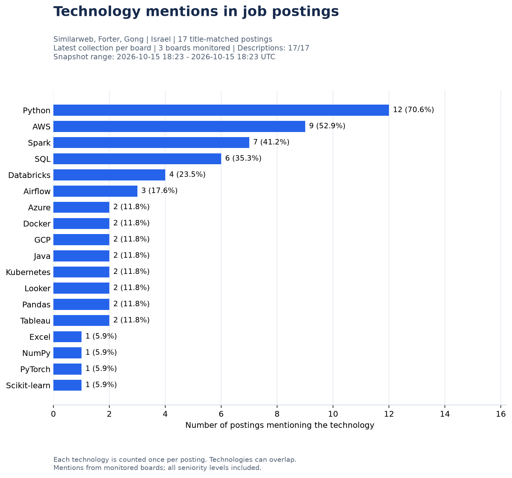

# Job Market Tracker

A Python ETL pipeline that collects public job postings, preserves
collection history in SQLite, and visualizes technology mentions
in Israel-based Data, BI, and AI-related roles.

## Project goal

Build a reproducible workflow for exploring job requirements and
changes across collection dates.

The pipeline is configured to monitor Similarweb, Forter and Gong,
including all seniority levels. Identifying student and entry-level
opportunities from description requirements is a future extension.

## Current implementation

- Fetch public job postings and full descriptions from Greenhouse.
- Save raw job records with UTC collection metadata as JSON snapshots.
- Normalize nested fields and clean text columns using Pandas.
- Filter locations using explicit Israel and Tel Aviv matching rules.
- Assign job-family, role-match, and seniority hints using title rules.
- Validate records and store collection history in SQLite.
- Extract technology mentions from job descriptions.
- Generate technology-mention and collection-coverage CSV reports and a Matplotlib chart.
- Run the complete pipeline through `main.py` with progress and error logging.

## Latest report



[View the CSV report](reports/technology_mentions.csv)

Reports analyze title-matched postings from the latest stored
collection of each configured board. Collections are selected by
their snapshot timestamps, so historical observations are not added
to the current posting count.

[View collection coverage](reports/collection_coverage.csv) for each
board's collection ID, timestamp, raw and Israel posting counts,
matched posting count, and empty matched-description count. Boards
with zero matches remain in this report. Missing board collections
raise an error instead of silently reducing the reporting scope.

In the technology CSV, `board_tokens` and `collection_ids` share the
same order. Snapshot time bounds show the range of collection times.
The coverage CSV retains these details even when the technology CSV
has no data rows.

Each technology is counted once per posting. Percentages use all
analyzed postings as the denominator. A posting can mention multiple
technologies, so percentages do not need to sum to 100%.

## Data source

- Provider: Greenhouse Job Board API
- Boards: Similarweb (`similarweb`), Forter (`forter`), Gong (`gongio`)
- Configuration: `GREENHOUSE_BOARDS` in `config.py`
- Authentication: No API key required for the public GET endpoint
- Documentation: [Greenhouse Job Board API](https://docs.greenhouse.io/job-board.html)

The extraction requests full descriptions using `content=true`.

## Local setup

Tested with Python 3.12.10 on Windows.

From the project directory, run these commands in PowerShell:

```powershell
python -m venv .venv
.\.venv\Scripts\python.exe -m pip install -r requirements.txt
.\.venv\Scripts\python.exe main.py
```

A successful run saves one raw snapshot per board, loads the processed
records into SQLite, and updates the technology CSV, chart, and
collection-coverage CSV.

To regenerate reports from the latest stored collection per board without
fetching new data:

```powershell
.\.venv\Scripts\python.exe visualize.py
```

If Windows prevents overwriting a report, close the application
displaying that file and rerun `visualize.py`.

## Project structure

| File | Responsibility |
| --- | --- |
| `config.py` | Configure board identifiers and company display names |
| `extract.py` | Fetch postings from the public API |
| `raw_storage.py` | Save raw records and collection metadata |
| `transform.py` | Normalize records and apply location rules |
| `job_rules.py` | Classify job titles and seniority hints |
| `schema.sql` | Define tables, keys, and constraints |
| `database.py` | Initialize the database and inspect row counts |
| `load.py` | Validate and load a collection transactionally |
| `skill_analysis.py` | Select the latest collection per board using SQL and extract technology mentions |
| `visualize.py` | Export technology mentions, chart, and collection coverage |
| `main.py` | Coordinate the complete pipeline |
| `requirements.txt` | Record Python dependencies |
| `tests/test_multi_company.py` | Check collection selection, reporting, and pipeline failure behavior offline |

## Data storage and collection history

The database is stored at `data/job_market.sqlite3`.

- `collection_runs`: Collection metadata, timestamps, and posting counts.
- `job_snapshots`: Postings associated with each collection, including
  descriptions and classification results.

All postings passing the Israel location rules are stored, including
`matched`, `needs_review`, and `not_matched` role statuses.
Technology reports use only `matched` postings.

A collection is identified by its source, board token, and UTC
snapshot timestamp. Loading the same snapshot again refreshes that
collection without adding another copy.

A new extraction creates a new collection. The same posting can
therefore appear across multiple dates as part of its history.

Each pipeline execution collects every configured board. Board loads
use separate transactions: a later failure leaves earlier successful
collections available for inspection. Reports are generated after all
boards complete. Standalone report generation reads the latest stored
collection per board; the coverage CSV makes their timestamps explicit.

For this small portfolio version, the SQLite database and latest
reports are included in version control. Raw JSON snapshots,
virtual environments, and temporary files are excluded by `.gitignore`.

## Initial verified local run

An end-to-end Similarweb run on 2026-10-14 produced:

| Metric | Count |
| --- | ---: |
| Postings received | 68 |
| Postings matching Israel location rules | 29 |
| Postings matching role-title rules | 14 |
| Postings flagged for role review | 1 |

The database load and both report exports completed successfully.
Posting counts can change between runs.

## Interpretation and limitations

- Coverage is limited to the configured companies and does not represent
  the entire Israeli job market.
- Location matching uses a limited set of text rules and may miss
  other location formats.
- Role and seniority labels are title-based heuristics. A title
  without a seniority keyword does not establish junior suitability.
- Technology detection uses a configured keyword dictionary.
  Mentions do not necessarily indicate mandatory requirements.
- The chart summarizes the latest collection per board. Historical trend
  visualization has not yet been implemented.

## Offline checks

Run from the project directory in PowerShell:

```powershell
.\.venv\Scripts\python.exe -m unittest discover -s tests -v
```

The checks use synthetic postings, mocked API calls, and temporary
databases and reports. They cover older snapshots loaded later,
zero-match boards, overlapping posting IDs across boards, empty
descriptions, missing sources, and failures before report generation.

## Automation

The pipeline runs through GitHub Actions using
[the workflow configuration](.github/workflows/job_market_etl.yml).

- Scheduled daily at 06:17 UTC.
- Supports manual execution from Actions → Daily Job Market ETL → Run workflow.
- Runs on GitHub infrastructure, independently of the local computer.
- Runs the offline checks before collecting live data.
- Commits the updated SQLite database, both CSV reports, and chart to `main`
  after a successful pipeline run.
- Retains raw JSON snapshots as downloadable workflow artifacts for 14 days.
- Prevents simultaneous executions of this workflow.

Scheduled runs may be delayed by GitHub Actions.

The first manual GitHub Actions run completed successfully.
Its output commit was pulled locally, confirming that the new
collection was added while previous collection history was preserved.

Scheduled execution of the initial Similarweb version was verified
on 2026-10-15.
Two runs triggered by `schedule` completed successfully, and their
database and report updates were pulled into the local repository.

## Continuing local development

Before editing or running the project locally, synchronize the
latest automated updates with `git pull --ff-only`.

This keeps the local database and reports aligned with the
latest successful GitHub Actions run.

## Planned extensions

- Expand the monitored company set after checking source data quality.
- Analyze experience requirements in descriptions to improve
  identification of student and entry-level opportunities.
- Visualize changes across collection dates.
